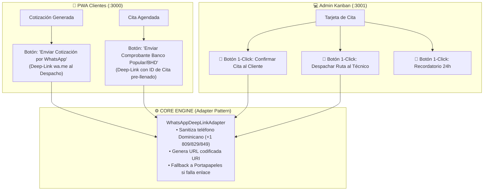

# 🚀 MITEFREE — Plan Maestro de Ejecución Fase por Fase (Estrategia WhatsApp Sin API)

> **Organización:** ALR COMPANY — División de Ingeniería de Software  
> **Líder de Proyecto & Founder:** [Angel Luis Rosario](https://github.com/ALR1730)  
> **Referentes de Mentoría:** Ing. Leonardo · Héctor de León · Gentleman Programming  
> **Fecha de Emisión:** 12 de Octubre de 2026  
> **Premisa Clave:** Integración de **WhatsApp Asistido Sin API Oficial** (Zero Cost, Deep-Links Inteligentes `wa.me`, plantillas automáticas y disparadores de 1-click en PWA y Admin).

---

## 🧭 1. Enfoque Estratégico: "WhatsApp Operativo Sin API Oficial"

Dado que no se cuenta con la API oficial de Meta WhatsApp Cloud (evitando costos por mensaje, verificaciones burocráticas de empresa y restricciones de plantillas), implementaremos una **estrategia de WhatsApp Asistido de Ultra Alta Conversión** basada en la realidad comercial de República Dominicana.



### 🏛️ Cumplimiento del Triunvirato de Mentoría:
1. **Patrón Adapter / ACL (Gentleman Programming):**  
   Creamos la interfaz `IWhatsAppNotificationGateway`. La UI nunca genera enlaces crudos a mano. Se inyecta un adaptador que encapsula la generación de los enlaces `wa.me`. Si en el futuro ALR COMPANY decide contratar la Meta Cloud API, **solo se reemplaza este adaptador en la infraestructura; los componentes visuales jamás se tocan**.
2. **Strategy Pattern (Héctor de León):**  
   Estrategias de plantillas tipadas (`BookingConfirmationStrategy`, `TechnicianRouteStrategy`, `DepositReminderStrategy`) que construyen mensajes legibles, con emojis y formateados para WhatsApp.
3. **Pureza de Capas (Ing. Leonardo):**  
   La lógica de validación de teléfonos dominicanos y compilación de textos vive en `Application/Domain`, completamente desacoplada del navegador.

---

## 🗺️ 2. Hoja de Ruta Fase por Fase (Roadmap de Ejecución)

```
┌──────────────────────────────────────────────────────────────────────────────────┐
│                   SECUENCIA CRONOLÓGICA DE EJECUCIÓN (FASES 1 A 6)               │
├─────────┬─────────────────────────────────────────────────┬──────────────────────┤
│ FASE 1  │ 💬 Motor WhatsApp Asistido (Sin API) + Email    │ 🟢 100% COMPLETADO   │
│ FASE 2  │ 🗄️ Persistencia Nube Permanente (Neon Postgres)  │ 🔴 Prioridad P0      │
│ FASE 3  │ ☁️ Storage Cloudflare R2 + Generador de PDFs     │ 🟡 Prioridad P1      │
│ FASE 4  │ 💳 Pasarela Stripe Live + Conciliación Bancaria │ 🟡 Prioridad P1      │
│ FASE 5  │ ⚡ Automatización Asíncrona (Cron Jobs Ligero)  │ 🟢 Prioridad P2      │
│ FASE 6  │ 🧪 Playwright E2E + Docker Deploy Producción     │ 🟢 Prioridad P2      │
└─────────┴─────────────────────────────────────────────────┴──────────────────────┘
```

---

## 💬 FASE 1: Motor Transaccional de WhatsApp Asistido (Sin API) & Email

> **Objetivo:** Convertir el flujo de cotización y agenda en una máquina de conversión vía WhatsApp sin pagar un solo dólar a Meta, asistido por correos transaccionales con Resend.
> **Estado:** 🏆 **100% IMPLEMENTADO, CERTIFICADO Y TESTEADO (139/139 Tests)**

### 1.1 Backend & Dominio (`packages/domain-core` & `apps/api`)
- [x] **Value Object & Sanitización Dominicana:** Normalización de números dominicanos (`+1 809/829/849`) a formato canónico `1809XXXXXXX`.
- [x] **Engine de Plantillas (`WhatsAppMessageEngine`):**
  - **Plantilla A (Cotización):** Generación de resumen con desglose, anticipo del 30% y enlace.
  - **Plantilla B (Confirmación a Cliente):** Código de cita, cuadrilla, fecha, anticipo recibido y saldo restante.
  - **Plantilla C (Despacho a Cuadrilla):** Ruta con enlace automático a Google Maps (`/maps/search/?api=1&query=...`) y tareas.
  - **Plantilla D (Recordatorio 24 Horas):** Alerta previa con recomendaciones de despeje de mobiliario.
  - **Plantilla E (Envío de Comprobante):** Mensaje prellenado para adjuntar comprobante del Banco Popular, Banreservas o BHD.
- [x] **Generador Canónico de Deep-Links (`wa.me`):** URL codificada segura (`encodeURIComponent`) con salvaguarda de errores.
- [x] **TDD Suite en `domain-core`:** 8/8 pruebas unitarias pasando (`whatsapp-message.engine.spec.ts`).

### 1.2 Frontend PWA (`apps/pwa-client`)
- [x] **`WhatsAppClientAdapter`:** Capa de adaptación desacoplada del UI según Clean Architecture de Alan Buscaglia.
- [x] Botón CTA en `/cotizar` (`QuoteSummaryStep.tsx`): **"Pedir por WhatsApp"** con enlace dinámico generado por el engine.
- [x] Pantalla de éxito en `/agenda` (`BookingSuccessView.tsx`): Botón **"Confirmar por WhatsApp al Despacho"** con ID de cita y dirección.
- [x] Salvaguarda de portapapeles: si el navegador bloquea la ventana emergente, copia el texto automáticamente.

### 1.3 Frontend Admin Portal (`apps/admin-portal`)
- [x] **`WhatsAppAdminAdapter`:** Capa de adaptación para operaciones de despacho.
- [x] En cada tarjeta del tablero **Kanban de Citas (`/citas`)**:
  - Botón verde de WhatsApp: **"WA Cliente"** (1-Click abre chat con el cliente con la plantilla formal de confirmación).
  - Botón cyan de WhatsApp: **"Despacho WA"** (1-Click despacha a la cuadrilla con mapa de Google Maps).
- [x] Toast flotante de retroalimentación interactiva (*"Abriendo WhatsApp..."* / *"Copiado al portapapeles"*).

### 1.4 Email Transaccional con Resend (`apps/api`)
- [x] **`ResendEmailAdapter`:** Integración de la API REST de Resend con fallback seguro en desarrollo cuando no hay `RESEND_API_KEY`.
- [x] Plantilla HTML responsiva para confirmación formal de cita con branding MITEFREE.
- [x] **`WhatsAppNotificationAdapter`:** Wrapper a nivel de infraestructura en NestJS.
- [x] **TDD Suite en `api`:** 5/5 pruebas unitarias pasando (`notifications.spec.ts`).

---

## 🗄️ FASE 2: Persistencia Permanente en la Nube (Neon PostgreSQL)

> **Objetivo:** Migrar del almacenamiento temporal en memoria a una base de datos PostgreSQL Serverless permanente en Neon sin perder el modo fallback de desarrollo.

- [ ] Creación de rama de base de datos en **Neon Console** (`mitefree_production` y `mitefree_dev`).
- [ ] Configuración segura de la variable `DATABASE_URL` en `.env` (SSL obligatoria `?sslmode=require`).
- [ ] Ejecución de migraciones relacionales con **Drizzle Kit**:
  ```bash
  bun run drizzle-kit push
  ```
- [ ] Verificación de integridad de los 6 esquemas (`users`, `quotations`, `appointments`, `payments`, `wallets`, `audit`).
- [ ] Ejecución del Seeder dominicano en la nube (`bun run db:seed`) para sembrar cuadrillas y catálogo base.

---

## ☁️ FASE 3: Almacenamiento Seguro Cloudflare R2 & Presupuestos en PDF

> **Objetivo:** Persistir evidencias de manchas subidas por clientes y generar cotizaciones descargables en PDF de alta fidelidad visual.

- [ ] Configuración de credenciales de **Cloudflare R2** en `.env`:
  - `CLOUDFLARE_R2_BUCKET_NAME`
  - `CLOUDFLARE_R2_ACCOUNT_ID`
  - `CLOUDFLARE_R2_ACCESS_KEY_ID`
  - `CLOUDFLARE_R2_SECRET_ACCESS_KEY`
- [ ] Validación de subida de fotos de manchas mediante Presigned URLs de subida binaria (`PUT`) con expiración estricta de 15 minutos (900 segundos).
- [ ] Servicio de Generación de Presupuestos en PDF con diseño formal enterprise de ALR COMPANY (número de cotización, desglose de telas, recargo de manchas, cálculo del 30% de anticipo y código QR hacia la web).

---

## 💳 FASE 4: Pagos en Vivo (Stripe Live + Banco Popular / Banreservas / BHD)

> **Objetivo:** Ofrecer cobros automáticos con tarjeta de crédito/débito y conciliar depósitos manuales con auditoría.

- [ ] Conexión de llaves de producción de Stripe (`STRIPE_SECRET_KEY` y `STRIPE_WEBHOOK_SECRET`).
- [ ] Verificación de firma criptográfica HMAC en el endpoint webhook `/api/v1/payments/webhook`.
- [ ] Prueba de ciclo de vida con tarjeta de prueba en Stripe Elements.
- [ ] Conciliación bancaria en Admin Portal:
  - Formulario donde el cliente sube la foto del comprobante del Banco Popular, Banreservas o BHD.
  - El administrador revisa la imagen en `/pagos` y presiona **"Aprobar Depósito"**.
  - Al aprobarse: la cita cambia automáticamente a `CONFIRMED` y se genera el enlace de WhatsApp para notificar al cliente.

---

## ⚡ FASE 5: Automatización Asíncrona & Tareas Programadas (Cron Ligero)

> **Objetivo:** Mantener el sistema limpio y automatizado sin incurrir en infraestructuras costosas de Redis.

- [ ] Implementación de tareas programadas mediante el scheduler interno de NestJS (`@nestjs/schedule`):
  - **Job 1 (Caducidad de Cotizaciones):** Se ejecuta a medianoche y marca como `EXPIRED` las cotizaciones con más de 7 días sin confirmación.
  - **Job 2 (Alerta Preventiva de Agenda):** Identifica citas de las próximas 24 horas y prepara la bandeja de recordatorios para los despachadores.
  - **Job 3 (Expiración de Puntos de Billetera):** Aplica la política de vencimiento de saldo de referidos a los 180 días en el libro mayor inmutable.

---

## 🧪 FASE 6: Suite E2E con Playwright & Despliegue a Producción

> **Objetivo:** Certificar la calidad con pruebas automáticas de navegador y desplegar el sistema con alta disponibilidad.

- [ ] **Pruebas Automatizadas con Playwright:**
  - Test E2E 1: Cliente entra a `/cotizar`, selecciona sofá de 3 plazas con tela de terciopelo, personaliza adicionales y pasa a la agenda.
  - Test E2E 2: Cliente agenda cita en Piantini y el sistema genera el deep-link de WhatsApp correcto.
  - Test E2E 3: El administrador entra al Kanban, mueve la cita a `EN_ROUTE` y verifica que el estado se refleje.
- [ ] **Contenerización y Despliegue:**
  - Build de la API con Docker Multi-Stage (`oven/bun:1-slim`, ~120MB).
  - Despliegue de `apps/api` en Railway / Fly.io / VPS.
  - Despliegue de los frontends `pwa-client` y `admin-portal` en Vercel.
  - Monitoreo de errores con **Sentry** y telemetría de salud en `/health`.

---

## 🏁 Definición de Éxito y Criterios de Aceptación Global

1. **Cero Dependencia de Meta API:** Ninguna funcionalidad de comunicación se detiene por falta de token de WhatsApp Cloud API; los deep-links `wa.me` operan al 100% de forma instantánea.
2. **126/126 Tests Manteniéndose Verdes:** Ninguna nueva funcionalidad rompe el 100% de éxito de las pruebas unitarias ni las reglas de Onion Architecture.
3. **Cero Deuda Técnica:** Código limpio, sin `any`, con Screaming Architecture y adaptadores desacoplados.

---
*Plan Estratégico diseñado por ALR COMPANY — División de Ingeniería de Software.*  
*Aprobado para ejecución inmediata bajo la supervisión de Angel Luis Rosario.*
